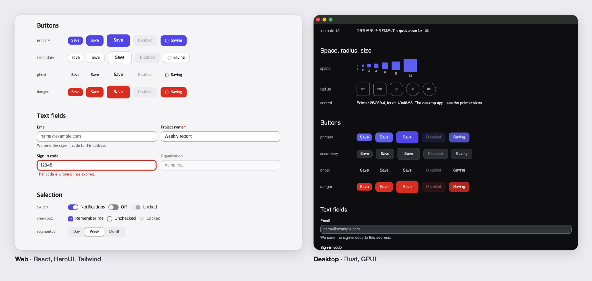
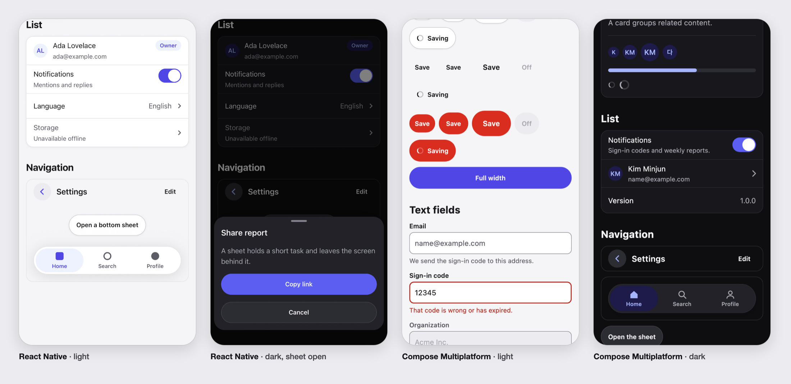
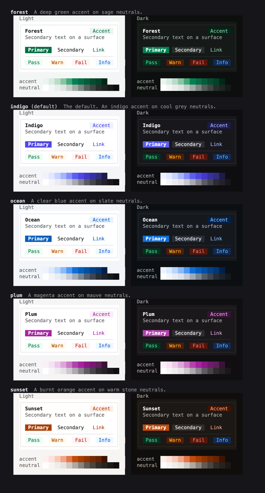

# xds

[English](README.md)

크로스플랫폼 디자인 시스템 템플릿입니다. 단일 디자인 토큰 세트를 기반으로 클라이언트별 컴포넌트 라이브러리를 생성하며, 각 클라이언트에는 이를 사용하는 작은 앱이 포함되어 있습니다. 명령줄 도구(`xds`)를 사용하면 필요한 클라이언트만 선택해 새 프로젝트를 생성할 수 있습니다.





| 클라이언트 | 실행 환경 | 스택 | 컴포넌트 | 앱 |
| --- | --- | --- | --- | --- |
| `web-react` | 브라우저 | React 19, Vite, Tailwind v4, HeroUI v3 | `packages/ui` | `apps/web` |
| `desktop-gpui` | macOS | Rust, GPUI, GPUI Component | `crates/acme-ui` | `apps/desktop` |
| `mobile-react-native` | iOS, Android | React Native, Expo | `packages/ui-native` | `apps/mobile` |
| `kotlin-compose` | Android, iOS, 데스크톱 | Kotlin Multiplatform, Compose Multiplatform | `kotlin/ui` | `kotlin/androidApp`, `kotlin/iosApp`, `kotlin/desktopApp` |

`acme`는 플레이스홀더 이름이며, `xds create` 실행 시 입력한 프로젝트 이름으로 치환됩니다.

## 시작하기

```sh
xds create my-app
```

`xds`를 실행하면 프로젝트 이름, 포함할 클라이언트, 컬러 테마를 차례로 입력받아 선택한 클라이언트만 포함된 저장소를 생성합니다. 테마 목록을 이동할 때마다 터미널에 해당 테마의 미리보기가 바로 렌더링됩니다. 각 프롬프트는 기본값(디렉터리 이름, 웹 클라이언트, indigo 테마)이 선택된 상태로 시작하며, `--yes`를 전달하면 묻지 않고 이 기본값을 사용합니다.

```sh
# 질문 없이 만들기:
xds create my-app --name orbit --targets web-react,kotlin-compose --theme ocean
xds add desktop-gpui          # 나중에 클라이언트 추가
xds theme sunset              # 나중에 테마 변경
```



### xds 설치

아직 배포된 릴리스가 없습니다. 첫 릴리스가 나오기 전까지는 저장소를 클론해 직접 빌드해야 합니다.

```sh
git clone https://github.com/kjmin-dev/xds && cd xds
mise install
cargo install --path cli
```

릴리스가 배포된 이후에는 npm이나 설치 스크립트로 설치할 수 있습니다.

```sh
npm install --global xds-cli        # 또는: npm create xds@latest my-app
curl -fsSL https://raw.githubusercontent.com/kjmin-dev/xds/main/install.sh | sh
```

전체 명령어와 선택한 클라이언트만 추출하는 방식, 새로운 클라이언트 스택을 추가하는 방법은 [CLI 문서](docs/cli.md)(영문)를 참고하세요.

## 코딩 에이전트와 함께 쓰기

`xds`는 터미널에서 직접 작업할 때나 코딩 에이전트를 사용할 때 디자인 시스템의 구성을 조회하는 명령어도 제공합니다.

```sh
xds tokens button.primary                         # 라이트·다크 모드의 토큰 값
xds components Button                             # 옵션, 상태, 클라이언트별 소스 파일
xds contrast text.secondary background.surface    # 두 모드의 WCAG 명암비
xds doctor                                        # 프로젝트 상태가 일관적인지 확인
```

모든 명령어는 구조화된 출력을 위한 `--json` 플래그를 지원합니다. 또한 코딩 에이전트와 연동할 수 있는 세 가지 방법을 제공합니다.

- `AGENTS.md`에는 디자인 시스템의 규칙과 관례가 정리되어 있습니다. `xds create`로 새 프로젝트를 생성하면 선택한 클라이언트에 맞는 내용만 담긴 `AGENTS.md`가 함께 생성됩니다.
- `skills/xds`는 [Agent Skill](https://agentskills.io)입니다. `npx skills add kjmin-dev/xds`로 설치하거나, Claude Code에서는 `/plugin install xds --marketplace kjmin-dev/xds`로 설치할 수 있습니다.
- `xds mcp`는 동일한 명령어를 MCP 도구로 노출하는 stdio 기반 Model Context Protocol 서버입니다. `claude mcp add xds -- xds mcp`로 등록해 사용합니다.

JSON 출력 형식과 종료 코드에 대한 자세한 내용은 [CLI 문서](docs/cli.md#for-scripts-and-agents)(영문)를 참고하세요.

## 주요 구성

- `design/tokens`에는 DTCG 형식의 디자인 토큰이 들어 있습니다. 컬러 팔레트, 라이트·다크 모드 시맨틱 컬러, 컴포넌트 전용 컬러, 타이포그래피 역할, 여백, 모서리 반경, 모션, 그림자, 포인터 및 터치 입력 환경별 컨트롤 크기를 정의합니다.
- `design/themes`에는 `indigo`(기본값), `ocean`, `forest`, `sunset`, `plum` 다섯 가지 컬러 테마가 있습니다. 각 테마는 강조색(accent) 단계와 무채색(neutral) 단계로 구성되며, 모든 테마가 전체 명암비 검사를 통과합니다.
- `tools/design-build`는 토큰을 CSS 커스텀 프로퍼티, Tailwind 테마, TypeScript 상수, Rust 상수, Compose 값으로 컴파일합니다. 외부 의존성 없이 Node만으로 실행되며, 색상 조합의 명암비가 WCAG 기준에 미달하면 빌드가 실패합니다.
- 모든 클라이언트는 동일한 이름과 옵션을 가진 컴포넌트를 구현합니다: Button, TextField, Text, Badge, CountBadge, Banner, Card, Divider, Spinner, Switch, Checkbox, SegmentedControl, Avatar, AvatarStack, ProgressBar, ListRow, Icon, IconButton, Chip, ChipBar, Tabs, Menu, Dialog, Toast, Skeleton, SearchField, RadioGroup, Select, Slider, Thumbnail, MediaCard, SectionHeader, EmptyState, Accordion. 터치 기반의 두 클라이언트에는 TopBar, TabBar, BottomSheet가, 포인터 기반의 두 클라이언트(웹, GPUI)에는 Tooltip과 Sidebar가 추가로 포함됩니다.
- 각 앱에는 모든 토큰과 컴포넌트를 한 화면에서 확인할 수 있는 디자인 프리뷰 화면이 포함되어 있습니다.

시스템 구조의 설계 배경과 최신 오픈소스 디자인 시스템에서 참고한 관례는 [디자인 시스템 문서](docs/design-system.md)(영문)에서 설명합니다.

## 이 저장소에서 작업하기

[mise](https://mise.jdx.dev)를 설치해 프로젝트에 고정된 버전의 Node, pnpm, Rust, Java를 구성합니다.

```sh
mise install
mise run check          # CI가 돌리는 것 전부
```

| 작업 | 명령어 |
| --- | --- |
| 웹 앱 실행 | `mise run //web:dev` 실행 후 `http://localhost:5173` 접속 |
| 웹 디자인 프리뷰 열기 | `http://localhost:5173/design` 접속 |
| GPUI 데스크톱 앱 실행 | `mise run //desktop:dev` |
| GPUI 디자인 프리뷰 열기 | `mise run //desktop:design` |
| React Native 앱 실행 | `mise run //mobile:ios` 또는 `mise run //mobile:android` |
| Compose 데스크톱 앱 실행 | `mise run //kotlin:desktop` |
| Compose 디자인 프리뷰 열기 | `mise run //kotlin:design` |
| Compose 앱을 Android에 설치 | `mise run //kotlin:android` |
| 토큰 파일 재생성 | `mise run tokens` |
| 테마 목록 확인 및 적용 | `mise run theme`, `mise run theme ocean` |
| 소스에서 CLI 실행 | `mise run xds -- list` |
| 문서 사이트 실행 | `mise run //docs:dev` 실행 후 `http://localhost:4321` 접속 |
| 전체 코드 포맷 | `mise run fmt` |

웹 컴포넌트 테스트는 Google Chrome에서 실행되므로 `mise run check`에는 Chrome이 설치되어 있어야 합니다. GPUI 데스크톱 앱은 macOS에서 빌드됩니다. Compose 앱을 빌드하려면 Android는 Android SDK, iOS는 Xcode가 필요합니다. 자세한 내용은 [kotlin/README.md](kotlin/README.md)(영문)를 참고하세요. 모바일 앱에서는 홈 화면의 버튼을 눌러 디자인 프리뷰를 열 수 있습니다.

## 디자인 수정하기

1. `design/tokens`의 토큰 JSON 파일을 수정하거나 `mise run theme <이름>`으로 테마를 변경합니다.
2. `mise run tokens`를 실행해 플랫폼별 파일을 다시 생성합니다. 토큰 형식이 잘못되었거나 색상 조합의 명암비가 기준치에 미달하면 빌드가 실패합니다.
3. 수정한 토큰 JSON 파일과 생성된 결과물을 함께 커밋합니다.

## 디렉터리 구조

```text
design/tokens/          원천
design/themes/          컬러 테마
design/icons/           아이콘 (SVG 파일)
tools/design-build/     토큰을 플랫폼 파일로 변환하고 대비를 검사
packages/tokens/        생성된 CSS와 TypeScript
packages/ui/            웹 컴포넌트
packages/ui-native/     React Native 컴포넌트
crates/acme-tokens/     생성된 Rust
crates/acme-ui/         GPUI 컴포넌트
kotlin/                 Compose 컴포넌트와 앱 (별도의 Gradle 빌드)
apps/web/               React 앱
apps/desktop/           GPUI 앱
apps/mobile/            Expo 앱
apps/docs/              문서 사이트 (프로젝트에는 복사되지 않음)
cli/                    xds 명령줄 도구
npm/                    xds 바이너리를 배포하는 npm 패키지
install.sh              설치 스크립트
template.json           어떤 경로가 어느 클라이언트에 속하는지
```

## 확인한 범위

| | 상태 |
| --- | --- |
| 웹 | 헤드리스 Chrome에서 라이트·다크 모드 디자인 프리뷰 확인 |
| GPUI 데스크톱 | macOS에서 앱 실행 및 라이트·다크 모드 프리뷰 확인 |
| React Native | iOS 시뮬레이터에서 라이트·다크 모드 및 바텀 시트 동작 확인. Android와 실제 기기는 아직 확인하지 않음 |
| Compose | 데스크톱, Android 에뮬레이터, iOS 시뮬레이터에서 확인. 자세한 내용은 [kotlin/README.md](kotlin/README.md) 참고 |
| `xds` | 개별 클라이언트만 선택한 프로젝트와 네 클라이언트를 모두 선택한 프로젝트를 생성해 macOS에서 각각의 `mise run check` 통과 확인. Linux·Windows 바이너리 및 릴리스 워크플로는 아직 실행하지 않음 |
| 접근성 | 명암비는 빌드 시 자동 검증. 웹의 인터랙티브 컴포넌트는 키보드·포커스·ARIA 동작을 헤드리스 Chrome에서 테스트. 스크린 리더 테스트는 어느 클라이언트에서도 진행하지 않음 |

## 라이선스

[MIT](LICENSE)
