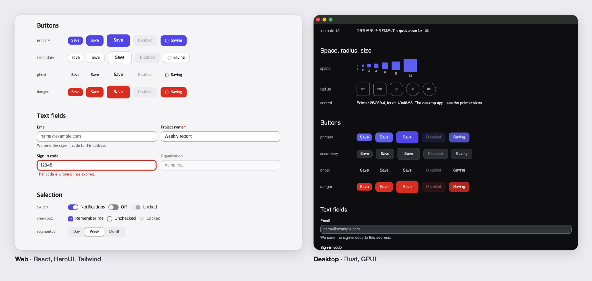
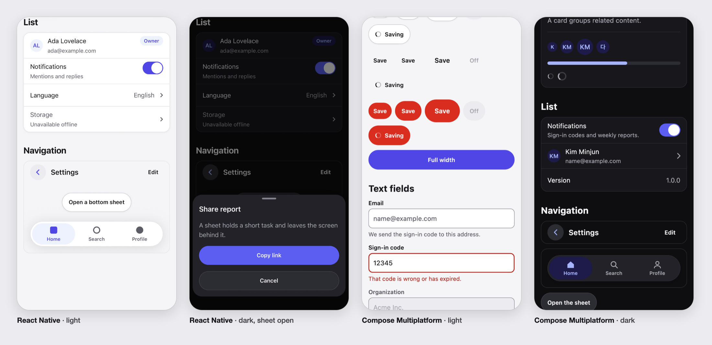
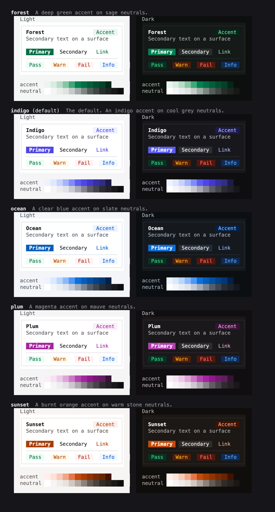

# xds

[한국어](README.ko.md)

A cross-platform design system template. A single set of design tokens drives a component library for each client, paired with a small app that uses it. The command-line tool (`xds`) scaffolds a new project containing only the clients you choose.





| Client | Runs on | Stack | Components | App |
| --- | --- | --- | --- | --- |
| `web-react` | Browsers | React 19, Vite, Tailwind v4, HeroUI v3 | `packages/ui` | `apps/web` |
| `desktop-gpui` | macOS | Rust, GPUI, GPUI Component | `crates/acme-ui` | `apps/desktop` |
| `mobile-react-native` | iOS, Android | React Native, Expo | `packages/ui-native` | `apps/mobile` |
| `kotlin-compose` | Android, iOS, desktop | Kotlin Multiplatform, Compose Multiplatform | `kotlin/ui` | `kotlin/androidApp`, `kotlin/iosApp`, `kotlin/desktopApp` |

`acme` is a placeholder name that `xds create` replaces with your project name.

## Getting started

```sh
xds create my-app
```

`xds` prompts for a project name, the clients to include, and a color theme, then generates a repository containing only those clients. As you move through the theme list, it renders a preview of each theme in the terminal.

```sh
# Or without questions:
xds create my-app --name orbit --targets web-react,kotlin-compose --theme ocean
xds add desktop-gpui          # add a client later
xds theme sunset              # change the theme later
```



### Installing xds

No release has been published yet. Until the first release is available, build it from a local checkout:

```sh
git clone https://github.com/kjmin-dev/xds && cd xds
mise install
cargo install --path cli
```

Once a release is published, you can install it via npm or the installer script:

```sh
npm install --global xds-cli        # or: npm create xds@latest my-app
curl -fsSL https://raw.githubusercontent.com/kjmin-dev/xds/main/install.sh | sh
```

See the [CLI documentation](docs/cli.md) for a full reference of all commands, how the template is filtered down to the selected clients, and how to add a new client stack.

## What's included

- `design/tokens` contains the design tokens in DTCG format: a color palette, light and dark semantic colors, component-specific colors, typographic roles, spacing, border radius, motion, shadows, and control sizes for pointer and touch input.
- `design/themes` provides five color themes: `indigo` (the default), `ocean`, `forest`, `sunset`, and `plum`. Each theme defines an accent ramp and a neutral ramp, and every theme passes all contrast checks.
- `tools/design-build` compiles the tokens into CSS custom properties, a Tailwind theme, TypeScript constants, Rust constants, and Compose values. It runs on plain Node with no external dependencies, and fails the build if any color pairing falls below its required WCAG contrast ratio.
- Every client implements the same set of components with matching names and options: Button, TextField, Text, Badge, Banner, Card, Divider, Spinner, Switch, Checkbox, SegmentedControl, Avatar, ProgressBar, and ListRow. The two touch clients also provide TopBar, TabBar, and BottomSheet.
- Each app includes a design preview screen that renders every token and component in a single view.

See the [design system documentation](docs/design-system.md) for the rationale behind this structure and the conventions it adopts from current open-source design systems.

## Working in this repository

Install [mise](https://mise.jdx.dev) to set up the pinned versions of Node, pnpm, Rust, and Java:

```sh
mise install
mise run check          # everything CI runs
```

| Task | Command |
| --- | --- |
| Start the web app | `mise run //web:dev`, then open `http://localhost:5173` |
| Open the web design preview | Visit `http://localhost:5173/design` |
| Start the GPUI desktop app | `mise run //desktop:dev` |
| Open the GPUI design preview | `mise run //desktop:design` |
| Start the React Native app | `mise run //mobile:ios` or `mise run //mobile:android` |
| Start the Compose desktop app | `mise run //kotlin:desktop` |
| Open the Compose design preview | `mise run //kotlin:design` |
| Install the Compose app on Android | `mise run //kotlin:android` |
| Regenerate token files | `mise run tokens` |
| List or apply a theme | `mise run theme`, `mise run theme ocean` |
| Run the CLI from source | `mise run xds -- list` |
| Format the codebase | `mise run fmt` |

The GPUI desktop app requires macOS. Building the Compose app requires the Android SDK for Android and Xcode for iOS; see [kotlin/README.md](kotlin/README.md) for details. In the mobile apps, use the button on the home screen to open the design preview.

## Changing the design

1. Edit the token JSON files in `design/tokens`, or switch themes with `mise run theme <name>`.
2. Run `mise run tokens` to regenerate the platform files. The build fails if a token is malformed or if any color pairing falls below its contrast threshold.
3. Commit both the updated token JSON files and the generated output.

## Repository layout

```text
design/tokens/          the source of truth
design/themes/          color themes
tools/design-build/     tokens to platform files, plus the contrast check
packages/tokens/        generated CSS and TypeScript
packages/ui/            web components
packages/ui-native/     React Native components
crates/acme-tokens/     generated Rust
crates/acme-ui/         GPUI components
kotlin/                 Compose components and apps (a Gradle build of its own)
apps/web/               React app
apps/desktop/           GPUI app
apps/mobile/            Expo app
cli/                    the xds command-line tool
npm/                    npm packages that deliver the xds binary
install.sh              the installer script
template.json           which paths belong to which client
```

## What has been checked

| | Status |
| --- | --- |
| Web | Design preview checked in headless Chrome in both light and dark modes |
| GPUI desktop | Run on macOS; design preview checked in both light and dark modes |
| React Native | Run on the iOS simulator in light and dark modes, including the bottom sheet. Android and physical devices have not been checked |
| Compose | Checked on desktop, an Android emulator, and the iOS simulator; see [kotlin/README.md](kotlin/README.md) for details |
| `xds` | Generated projects for each individual client and for all four combined; each passed its own `mise run check` on macOS. The Linux and Windows binaries and the release workflow have not been run |
| Accessibility | Contrast is verified by the build. No client has been tested with a screen reader |

## License

[MIT](LICENSE)
