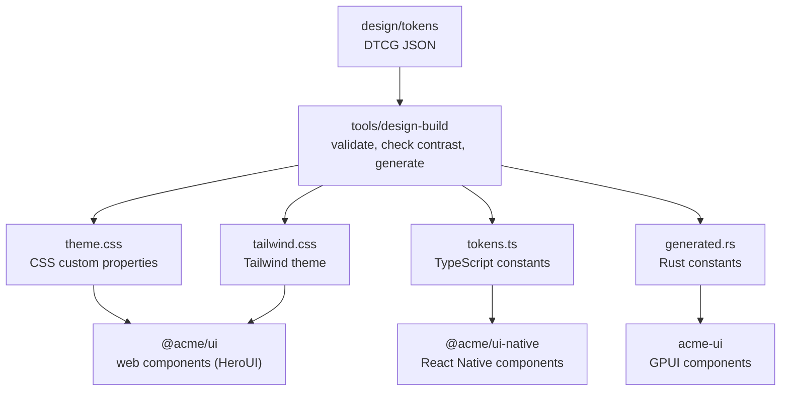
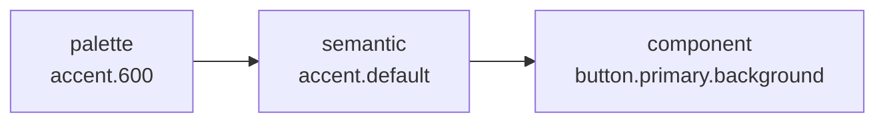

# The design system

A single set of token files acts as the source of truth, and each platform renders the same set of components from code generated out of those files.

- Platforms share design decisions rather than component code. Token names and values are shared, along with each component's variants, sizes, and tones, while each platform implements the rendering in its own stack.
- Color tokens are split into three tiers: a raw palette, semantic colors with a specific role, and component-specific colors. Application screens cannot reference the raw palette directly.
- Accessibility contrast is checked at build time. Every token build verifies 76 color pairings across both light and dark modes.
- Control heights scale with the input device—mouse pointer vs. finger—rather than screen width.
- Apps only import the design system package, never the underlying UI libraries directly (HeroUI v3 on web, GPUI Component on desktop, and React Native primitives on mobile).

## How it fits together

Generated files are committed to the repository. CI runs `mise run check:generated` to rebuild them and fails if the output differs from what was committed.

## Standards

| Standard | How it is kept here |
| --- | --- |
| Text has 4.5:1 contrast with its background (WCAG 2.2, 1.4.3) | Checked during the token build. Placeholder text is held to the same 4.5:1 threshold |
| Control boundaries and focus indicators have 3:1 (1.4.11) | Field borders and the focus color have dedicated tokens that are included in the contrast check |
| Color is never the only signal (1.4.1) | Badges carry text labels and banners use distinct mark shapes per tone. Invalid fields combine a thicker border with an error message |
| A pressable area is at least 24px (2.5.8); touch follows iOS 44pt and Android 48dp | Size tokens are split by input device. Touch uses 48, which satisfies both platform guidelines |
| A focus indicator is at least 2px thick (2.4.13) | Focus ring width and offset are defined as tokens |
| People can enlarge text (1.4.4) | Mobile respects the system text size, and controls set a minimum height rather than a fixed height |
| Reduced-motion settings are respected | When reduced motion is active, the spinner pulses slowly instead of spinning and button transitions are turned off |

The three-tier token structure follows the same approach used in Material Design 3 (reference, system, component) and GitHub Primer (base, functional, component).

## Tokens

### Source files

| File | Contents |
| --- | --- |
| `palette.json` | Six raw color ramps referenced by other tokens. Excluded from generated platform code |
| `color.light.json`, `color.dark.json` | Semantic colors and component colors. Every token name must exist in both modes |
| `base.json` | Space, radius, border, focus, type, motion, and shadow tokens |
| `size.pointer.json`, `size.touch.json` | Control sizes per input device |

Token files use the DTCG 2025.10 format, with separate files for each color mode and input device. While DTCG includes a Resolver module for describing multi-file sets like these, very few tools support it yet, so we do not use it here. Every color must be in sRGB: neither GPUI nor React Native can render a wider gamut, which means wide-gamut tokens would end up looking different across platforms.

### Three tiers of color

| Tier | Example | Who uses it |
| --- | --- | --- |
| Palette | `palette.accent.600` | Referenced only by semantic colors; omitted from the generated files |
| Semantic | `text.secondary`, `border.strong`, `status.danger` | Screens and components |
| Component | `button.primary.background-hover`, `field.border-invalid` | That specific component, on every platform |

Having a dedicated component tier means questions like "what color is a pressed primary button?" are answered once in the token files. Without that tier, each platform ends up making its own call in code, which is how implementations drift apart.

The semantic groups:

| Group | Tokens | Use |
| --- | --- | --- |
| background | base, surface, raised, disabled | Page backgrounds, cards, floating surfaces, disabled controls |
| text | primary, secondary, disabled, accent, on-accent, on-danger | Text colors (`on-*` is for text drawn on a colored fill) |
| border | default, strong, focus | Decorative dividers, control boundaries (3:1), focus rings |
| accent | default, hover, pressed, subtle | Primary view actions and selected states |
| control | default, hover, pressed | Neutral control fills |
| danger | default, hover, pressed | Destructive action fills |
| status | danger, success, warning, info, and a subtle of each | Status text and its matching tinted background |

Interactive state colors (hover, pressed) are defined as explicit solid values rather than alpha overlays. GPUI and React Native cannot blend colors at runtime, and explicit values allow the build script to verify contrast statically.

Rather than simply inverting the light palette, dark mode adjusts how elevation and contrast work: floating surfaces are separated by a lighter background fill instead of a shadow, and accent fills shift to a ramp step that keeps white text at 4.5:1 contrast.

### Type

Screens pick a typographic role rather than a raw font size. Each role sets font size, weight, line height, and tracking together.

| Role | Size / line height / weight | Use |
| --- | --- | --- |
| display | 28 / 1.25 / 700 | Used once per screen for the top-level view title |
| title | 22 / 1.25 / 700 | Section and dialog titles |
| heading | 18 / 1.4 / 600 | Card titles |
| body, body-strong | 16 / 1.5 / 400, 600 | Body copy and inline emphasis |
| label | 14 / 1.4 / 600 | Button and form field labels |
| detail | 14 / 1.5 / 400 | Helper descriptions and secondary lines |
| footnote | 12 / 1.4 / 600 | Badges and timestamps |

- Body text sits at 16px, which prevents iOS Safari from auto-zooming the page when an input field receives focus.
- Nothing goes below 12px, since Hangul strokes start blurring below that size.
- Body copy uses a 1.5 line height to give Hangul the extra vertical room it needs compared to Latin text at the same point size.
- Korean text breaks at word boundaries via `word-break: keep-all` on the web and `lineBreakStrategyIOS` on iOS.

The font stack puts Pretendard first and falls back to the system's Korean fonts. Because font files are not bundled in this repo, every platform renders with the system font until an app loads Pretendard itself. To switch typefaces, update `font.family.sans` in `base.json`.

On the web, the Tailwind config intentionally generates utilities per role (such as `text-acme-body`) and none for raw font sizes.

### Sizes

| Token | Pointer | Touch |
| --- | --- | --- |
| `size.control.sm` | 28 | 40 |
| `size.control.md` | 36 | 48 |
| `size.control.lg` | 44 | 56 |
| `size.target-min` | 24 | 48 |

On the web, `@media (pointer: coarse)` switches between the pointer and touch scales. Keying off input device rather than viewport width avoids false assumptions: a narrow laptop window is still operated with a mouse, and a large tablet is still operated with fingers. The desktop app always uses the pointer values, and the mobile app always uses the touch values.

Even when a button is visually smaller, it still responds to presses anywhere within `target-min`. On mobile, a small button draws at 40px tall but extends its hit area out to 48px.

### Everything else

| Group | Values | Rule |
| --- | --- | --- |
| space | 4, 8, 12, 16, 24, 32, 48 | 4px grid; each token name is the multiple of 4 |
| radius | sm 6, md 10, lg 16, full | Used for small inner parts of a control, controls themselves, and larger containers |
| border.width | thin 1, thick 2 | `thick` is reserved for states that cannot rely on color alone |
| focus | width 2, offset 2 | The 2px offset keeps the focus ring from blending into the control's fill |
| motion.duration | fast 120, normal 200, slow 320 | Press feedback, elements appearing, and large surface transitions |
| motion.easing | standard, enter, exit | On-screen movement, elements entering, and elements exiting |
| shadow | raised, overlay | Shadows barely show in dark mode, where surface fill colors carry elevation instead |

### What the build rejects

- Colors outside the sRGB gamut, or colors whose hex value disagrees with their channel components
- Lengths not in `px`, durations not in `ms`, or inset shadows
- Tokens defined for only one color mode or only one input device
- Color pairings that fall below the required contrast ratio (the error output names the pairing, color mode, and measured ratio)

## Components

### The contract

Every platform exposes the same component names, variants, sizes, and tones.

| Component | Options | Rule |
| --- | --- | --- |
| Button | variant: primary, secondary, ghost, danger. size: sm, md, lg. disabled, loading | At most one primary button per view; use a verb for the label |
| TextField | label, description, error, disabled | Always show a visible label; a placeholder is not a substitute for a label |
| Text | variant: the type roles. tone: primary, secondary, accent, danger, success, warning | Choose the element for the document outline and set its visual style with `variant` |
| Badge | tone: neutral, accent, success, warning, danger. dot | The label text carries the meaning, with color reinforcing it |
| Banner | tone: info, success, warning, danger. title | Each tone uses a distinct mark shape; warnings and errors interrupt screen readers |
| Card | title, description, actions | Separated from the background by an outline rather than a shadow |
| Divider, Spinner | | A spinner is announced to assistive tech only when given a label |

States:

| State | Rule |
| --- | --- |
| hover, pressed | Each state steps one shade darker; touch devices do not use hover |
| focus | Focus rings appear only when focus moves via the keyboard |
| disabled | Recolored with dedicated tokens rather than faded by opacity, since a faded colored fill still looks pressable |
| loading | Keeps both its label (so button width stays fixed) and its active colors, since the action is in progress rather than unavailable |
| invalid | Switches to a thicker red border and replaces the description with the error message; clear the error as soon as the user edits the value |

That last rule prevents a common form bug on the web: because an invalid field blocks form submission, leaving the error state attached after the user edits the field makes it impossible to resubmit the corrected value.

### Per platform

| | Web | Desktop | Mobile |
| --- | --- | --- | --- |
| Package | `@acme/ui` | `acme-ui` | `@acme/ui-native` |
| Built on | HeroUI v3 (React Aria) | GPUI Component | React Native primitives |
| Tokens arrive as | CSS custom properties and a Tailwind theme | Rust constants | TypeScript constants |
| Sizes | Follow the input device | Pointer | Touch |
| Design preview | `/design` | `acme --design` | `/design` |

On the web, `heroui-theme.css` maps HeroUI's theme variables to the generated tokens, and `components.css` applies our token sizes and state colors to HeroUI's button and input. Those two files are the only places that know about HeroUI's internal naming. Only Button and TextField wrap HeroUI components (for their interaction behavior), while the remaining components are built directly with Tailwind utilities. Any unwrapped HeroUI component still picks up the right colors and border radius through the theme variables.

On desktop, `acme_ui::set_mode` applies the tokens to GPUI Component's theme. `button` returns a GPUI Component button configured with the right variant and height, whereas Badge, Banner, TextField, `card`, `divider`, and `text` are drawn directly.

On mobile, components are built directly on React Native's `Pressable` and `TextInput` without an external UI kit, and text scales with the system text size setting.

Where the platforms differ:

| | Difference |
| --- | --- |
| Disabled and loading buttons | Web and mobile recolor them; on desktop GPUI Component fades them |
| An invalid field | Web and mobile thicken the border; desktop draws a second outline around it |
| The banner's mark | A shape icon on the web; a letter in a circle on desktop and mobile |

### The design preview

Every platform includes a preview screen that renders all tokens and components in the same order—colors, type, space, radius, sizes, buttons, text fields, badges, banners, and cards—so you can put the apps side by side and compare them directly. The color swatches are populated from the generated token exports, so adding a new color token updates the preview automatically.

| | How to open it | Entry point | Light and dark |
| --- | --- | --- | --- |
| Web | `mise run //web:dev`, then `http://localhost:5173/design` | The button on the home screen | Follows the system. `?theme=light` and `?theme=dark` pin it |
| Desktop | `mise run //desktop:design` or `acme --design` | The button in the home window | Follows the system. The button in the window switches it, and `--light` or `--dark` pins it |
| Mobile | The `/design` screen | The button on the home screen | Follows the system |

On the web, the preview code is lazy-loaded only when `/design` is visited. A static host needs to serve `index.html` for `/design`.

## Keeping the platforms consistent

| What | How | State |
| --- | --- | --- |
| Token values | Generated files are committed, and CI regenerates and diffs them | Automated |
| Contrast | The token build checks every pairing in both modes | Automated |
| Component options | Component types on each platform are kept in sync by hand rather than generated from a single schema | Manual |
| Looks | Open the design preview on each platform and compare visually; nothing diffs screenshots automatically | Manual |

## Known limits

| | What | What to do about it |
| --- | --- | --- |
| HeroUI's class names | `components.css` targets HeroUI's classes and per-component variables. If HeroUI renames them, control sizes and state colors fall back to its defaults | Check the design preview when upgrading HeroUI. Core colors and border radius survive through the theme variables |
| GPUI Component | Still on 0.x with weekly releases | Pinned to an exact version and wrapped behind `acme-ui` |
| Mobile | The preview has been verified on the iOS simulator in both light and dark modes, but Android and physical devices have not been checked | |
| Desktop accessibility | Has not been tested with a screen reader | |
| Korean line breaking on Android | React Native has no word-boundary line-break option on Android | |
| Icons and strings | Neither an icon set nor a localization setup is included | |
