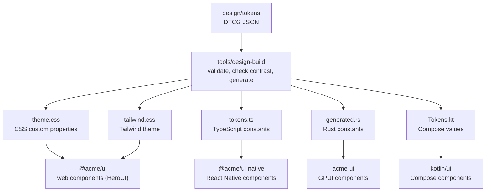
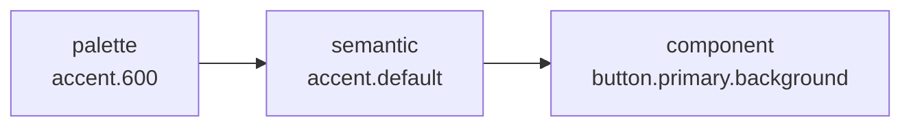

# The design system

A single set of token files serves as the source of truth, and each platform renders the same set of components using code generated from those files.

- Platforms share design decisions rather than component code. Token names and values are shared across targets, along with each component's variants, sizes, and tones, while each platform implements the rendering natively in its own stack.
- Color tokens are organized into three tiers: a raw palette, semantic colors tied to UI roles, and component-specific colors. Application screens never reference the raw palette directly.
- Accessibility contrast is verified at build time. Every token build checks 110 color pairings across both light and dark modes.
- Control heights scale with the input device (mouse pointer vs. touch) rather than screen width.
- Applications import only the design system package, never the underlying UI libraries directly (HeroUI v3 on web, GPUI Component on desktop, React Native primitives on mobile, and Compose foundation in the Kotlin client).
- Accent and neutral colors are defined as themes. Five themes ship with the template, and switching between them swaps two color ramps in the palette without changing anything else.

## How it fits together



`design/build.json` configures which output files the generator writes and where they are placed. A project scaffolded with a subset of clients lists only the outputs it needs.

The generator has no dependencies beyond Node itself: `node tools/design-build/src/build.ts` runs it directly, which is what `mise run tokens` invokes.

Generated files are committed to the repository. CI runs `mise run check:generated` to rebuild them and fails if the output differs from the committed files.

## Standards

| Standard | How it is enforced |
| --- | --- |
| Text has 4.5:1 contrast with its background (WCAG 2.2, 1.4.3) | Verified during the token build. Placeholder text is held to the same 4.5:1 threshold |
| Control boundaries and focus indicators have 3:1 (1.4.11) | Field borders and the focus ring color have dedicated tokens included in the contrast check |
| Color is never the only signal (1.4.1) | Badges carry text labels and banners use distinct mark shapes per tone. Invalid fields combine a thicker border with an error message |
| A pressable area is at least 24px (2.5.8); touch follows iOS 44pt and Android 48dp | Size tokens are separated by input device. Touch uses 48, satisfying both platform guidelines |
| A focus indicator is at least 2px thick (2.4.13) | Focus ring width and offset are defined as tokens |
| People can enlarge text (1.4.4) | Mobile respects the system text size setting, and controls set a minimum height rather than a fixed height |
| Reduced-motion settings are respected | When reduced motion is active, the spinner pulses slowly instead of rotating, and presses, switches, and sheets change state without animating. The Compose desktop app is the exception, since the JVM cannot read the OS setting |

The three-tier token structure follows the same model used in Material Design 3 (reference, system, component) and GitHub Primer (base, functional, component).

## Tokens

### Source files

| File | Contents |
| --- | --- |
| `palette.json` | Six raw color ramps referenced by other tokens. Excluded from generated platform code. The accent and neutral ramps come from the active theme |
| `color.light.json`, `color.dark.json` | Semantic colors and component colors. Every token name must exist in both modes |
| `base.json` | Space, radius, border, focus, type, motion, and shadow tokens, plus the scrim color |
| `size.pointer.json`, `size.touch.json` | Control sizes per input device |

Token files use the DTCG 2025.10 format, with separate files for each color mode and input device. Although DTCG specifies a Resolver module for describing multi-file sets like these, tool support is still limited, so it is not used here. Every color must be in sRGB: neither GPUI nor React Native supports wider color gamuts, so wide-gamut tokens would render inconsistently across platforms.

### Three tiers of color



| Tier | Example | Used by |
| --- | --- | --- |
| Palette | `palette.accent.600` | Referenced only by semantic colors; omitted from generated files |
| Semantic | `text.secondary`, `border.strong`, `status.danger` | Application screens and components |
| Component | `button.primary.background-hover`, `field.border-invalid` | That specific component across every platform |

Keeping a dedicated component tier means questions like "what color is a pressed primary button?" are answered once in the token files. Without that tier, each platform ends up making its own choice in code, causing implementations to drift apart.

Semantic color groups:

| Group | Tokens | Use |
| --- | --- | --- |
| background | base, surface, raised, disabled | Page backgrounds, cards, floating surfaces, disabled controls |
| text | primary, secondary, tertiary, disabled, accent, on-accent, on-danger | Text colors (`on-*` is used for text drawn on a colored fill). `tertiary` is used for placeholders, timestamps, and marks such as chevrons; it maintains 4.5:1 contrast on the page and on surfaces, and is not used on raised surfaces |
| border | default, control, strong, focus | Decorative dividers; outlines on controls already identified by a label; control boundaries that require 3:1 contrast; focus rings |
| accent | default, hover, pressed, subtle | Primary view actions and selected states |
| control | default, hover, pressed | Neutral control fills |
| danger | default, hover, pressed | Destructive action fills |
| status | danger, success, warning, info, plus a subtle variant of each | Status text and its matching tinted background |

Interactive state colors (hover and pressed) are defined as explicit solid values rather than alpha overlays. GPUI and React Native cannot blend colors at runtime, and explicit values allow the build script to check contrast statically.

In light mode, the page background is slightly off-white while surfaces are pure white, allowing cards to stand out with just a hairline border and a subtle shadow. Rather than simply inverting the light palette, dark mode adjusts how elevation and contrast work: floating surfaces are distinguished by a lighter background fill instead of a shadow, and accent fills shift to a ramp step that maintains 4.5:1 contrast against white text.

### Themes

A theme is a JSON file in `design/themes` containing two ramps: accent and neutral. Semantic colors reference the palette by step (`accent.600`, `neutral.100`), so swapping those two ramps recolors the entire system without touching any semantic or component tokens.

| Theme | Accent | Neutrals |
| --- | --- | --- |
| `indigo` (default) | Indigo | Cool grey |
| `ocean` | Blue | Slate |
| `forest` | Deep green | Sage |
| `sunset` | Burnt orange | Warm stone |
| `plum` | Magenta | Mauve |

```sh
mise run theme            # list the themes
mise run theme ocean      # apply one and regenerate the platform files
```

Every theme passes all contrast checks, and the test suite enforces this. `tools/design-build/src/make-theme.ts` constructs each ramp by matching the relative luminance of the corresponding step in `indigo` while changing only hue and chroma. Because WCAG contrast depends solely on relative luminance, all contrast ratios carry over unchanged.

```sh
# A new theme: an accent hue in OKLCH degrees, and optionally how vivid it is.
node tools/design-build/src/make-theme.ts coral --hue 25 --chroma 0.9 --description "A coral accent."
```

The status ramps (red, green, amber, blue) remain fixed across themes so that warnings and errors look consistent regardless of the active accent color.

### Typography

Screens select a typographic role rather than a raw font size. Each role bundles font size, weight, line height, and letter spacing together.

| Role | Size / line height / weight | Use |
| --- | --- | --- |
| display | 28 / 1.25 / 700 | Top-level view title, used at most once per screen |
| title | 22 / 1.25 / 700 | Section and dialog titles |
| heading | 18 / 1.4 / 600 | Card titles |
| body, body-strong | 16 / 1.5 / 400, 600 | Body copy and inline emphasis |
| label | 14 / 1.4 / 500 | Button and form field labels |
| detail | 14 / 1.5 / 400 | Helper descriptions and secondary text |
| footnote | 12 / 1.4 / 500 | Badges and timestamps |

- Body text is set at 16px, preventing iOS Safari from auto-zooming the page when a text input receives focus.
- The minimum font size is 12px, since Hangul glyphs become indistinct below that size.
- Body copy uses a 1.5 line height to give Hangul the extra vertical clearance it requires compared to Latin text at the same point size.
- Korean text wraps at word boundaries via `word-break: keep-all` on the web and `lineBreakStrategyIOS` on iOS.

The font stack lists Pretendard first, followed by the system Latin fonts and then the system Korean fonts. This order matters when Pretendard is not loaded: Latin text falls back to the system font rather than the Latin glyphs of a Korean font. Because font files are not bundled in this repository, each platform renders with the system font unless the application loads Pretendard itself. To change the typeface, update `font.family.sans` in `base.json`.

On the web, the Tailwind configuration generates utility classes for typographic roles (such as `text-acme-body`) and omits utilities for raw font sizes.

### Sizes

| Token | Pointer | Touch |
| --- | --- | --- |
| `size.control.sm` | 28 | 40 |
| `size.control.md` | 36 | 48 |
| `size.control.lg` | 44 | 56 |
| `size.target-min` | 24 | 48 |
| `size.switch.width`, `size.switch.height` | 36 × 20 | 52 × 32 |
| `size.checkbox` | 18 | 24 |
| `size.list-row` | 40 | 56 |
| `size.bar` | 48 | 56 |
| `size.button-radius` | 10 | capsule |
| `size.icon.sm`, `md`, `lg` | 16, 20, 24 | 16, 20, 24 |
| `size.avatar.sm`, `md`, `lg` | 24, 32, 40 | 24, 32, 40 |
| `size.spinner.sm`, `md`, `lg` | 16, 24, 32 | 16, 24, 32 |
| `size.badge` | 24 | 24 |
| `size.progress` | 8 | 8 |

On the web, `@media (pointer: coarse)` switches between the pointer and touch scales. Keying off the input device rather than viewport width avoids common edge cases: a narrow browser window on a laptop is still used with a mouse, and a large tablet is still used with touch. The GPUI desktop app always uses pointer sizes, the React Native app always uses touch sizes, and the Compose client uses touch sizes on Android and iOS and pointer sizes on desktop.

Even when a control is visually smaller than `target-min`, its hit area expands to meet the minimum target size. On mobile, a small button renders at 40px tall while accepting touches across a 48px height.

### Other tokens

| Group | Values | Rule |
| --- | --- | --- |
| space | 2, 4, 6, 8, 10, 12, 16, 20, 24, 32, 40, 48, 64 | 4px grid; each token name corresponds to its multiple of 4. `0-5`, `1-5`, and `2-5` are half steps used inside controls |
| radius | sm 6, md 10, lg 16, xl 24, full | Inner control elements, standard controls, containers, and floating surfaces detached from screen edges (sheets) |
| border.width | thin 1, thick 2 | `thick` is reserved for states that cannot rely on color alone |
| focus | width 2, offset 2 | The 2px offset separates the focus ring from the control's fill |
| motion.duration | fast 120, normal 200, slow 320 | Press feedback, elements appearing, and large surface transitions |
| motion.easing | standard, enter, exit | On-screen movement, entering elements, and exiting elements |
| motion.press-scale | 0.97 | Scale factor applied to a button while pressed |
| motion.spring | default 700 / 0.9, fast 1400 / 0.9 | Spring stiffness and damping ratio used by React Native and Compose for presses, switches, and touch-driven motion. Web and GPUI use the duration and easing tokens instead |
| shadow | subtle, raised, overlay | Cards and outlined controls, floating bars and menus, and modal sheets. Because shadows are barely visible in dark mode, dark surfaces rely on lighter background fills to convey elevation |

### What the build rejects

- Colors outside the sRGB gamut, or colors whose hex string does not match their RGB channel values
- Dimensions not specified in `px`, durations not specified in `ms`, or inset shadows
- Tokens defined in only one color mode or only one input device file
- Color pairings that fall below their required WCAG contrast ratio (the error message reports the pairing name, color mode, and measured ratio)

## Components

### Component contract

Every platform exposes the same component names, variants, sizes, and tones.

| Component | Options | Rule |
| --- | --- | --- |
| Button | variant: primary, secondary, ghost, danger. size: sm, md, lg. disabled, loading | Use at most one primary button per view, with a verb for the label. Secondary buttons are outlined. Renders as a rounded rectangle for pointer input and a capsule for touch |
| TextField | label, description, error, disabled | Always display a visible label; placeholder text is not a substitute for a label |
| Text | variant: the type roles. tone: primary, secondary, accent, danger, success, warning | Choose the semantic element for the document outline and set its visual style with `variant` |
| Badge | tone: neutral, accent, success, warning, danger. dot | Pill-shaped. The text label carries the meaning, while color reinforces it |
| Banner | tone: info, success, warning, danger. title | Each tone uses a distinct mark shape; warnings and errors announce immediately to screen readers |
| Card | title, description, actions, flush | Separated from the page by a hairline border and subtle shadow. `flush` removes internal padding when the card wraps a list |
| Divider, Spinner | | A spinner is announced to assistive technologies only when given a label |
| Switch | checked, label, disabled | Used for settings that take effect immediately. Remains clearly visible when off, with a track that holds 3:1 contrast against the page |
| Checkbox | checked, label, disabled | Used for selections that are applied later when submitting a form |
| SegmentedControl | options, value, full width | The active segment is raised: a hairline border, a faint shadow, and a darker label set it apart from the track |
| Avatar | name. size: sm, md, lg | Displays initials visually while exposing the full name to assistive technologies |
| ProgressBar | value from 0 to 1, label | Used for operations with known progress; use a Spinner for indeterminate work |
| ListRow | title, description, leading, trailing, chevron, disabled | Interactive when given an action. Separate adjacent rows with a Divider |

Three additional navigation components exist only on the touch-oriented platforms (React Native and Compose):

| Component | Options | Rule |
| --- | --- | --- |
| TopBar | title, back action, trailing | Matches the page background with no bottom border. The back button is a circular control whose press area is as large as the minimum touch target |
| TabBar | items (label and icon), value | Holds three to five top-level destinations. Floats above the bottom edge as a capsule, with the active tab enclosed in its own pill so selection does not depend on color |
| BottomSheet | open, title, content | Floats inset from the screen edges. Closes when tapping the scrim, dragging down, or pressing the back button |

Icons are passed as slots. Because the template does not include an icon set, the design previews render simple geometric shapes where an app would pass icons.

Interactive states:

| State | Rule |
| --- | --- |
| hover, pressed | Each state steps one shade darker; touch devices do not use hover. Pressing a button also scales it down slightly, providing non-color feedback |
| focus | Focus rings appear only during keyboard navigation |
| disabled | Recolored using dedicated disabled tokens rather than reduced opacity, since a semi-transparent colored fill can still look interactive |
| loading | Preserves both its text label (keeping button width stable) and its active colors, since the action is in progress rather than unavailable |
| invalid | Switches to a thicker red border and replaces the helper description with the error message; clear the error state as soon as the user edits the field |

Clearing the error state on edit avoids a common web form trap: when an invalid state blocks form submission, leaving the field marked invalid while the user types prevents them from submitting the corrected value.

### Platform implementations

| | Web | Desktop | Mobile | Kotlin |
| --- | --- | --- | --- | --- |
| Package | `@acme/ui` | `acme-ui` | `@acme/ui-native` | `kotlin/ui` |
| Built on | HeroUI v3 (React Aria) and native inputs | GPUI Component | React Native primitives | Compose foundation |
| Runs on | Browsers | macOS | iOS, Android | Android, iOS, desktop (JVM) |
| Tokens arrive as | CSS custom properties and a Tailwind theme | Rust constants | TypeScript constants | Compose values (`Color`, `Dp`, `TextStyle`) |
| Sizes | Follow the input device | Pointer | Touch | Touch on phones, pointer on desktop |
| Design preview | `/design` | `acme --design` | `/design` | The button on the home screen |

On the web, `heroui-theme.css` maps HeroUI's theme variables to the generated tokens, and `components.css` applies the token sizes and state colors to HeroUI's button and input primitives. Those two stylesheets are the only files coupled to HeroUI's internal naming. Button and TextField wrap HeroUI components for their interaction and accessibility behavior. Switch, Checkbox, and SegmentedControl use native HTML inputs (a checkbox or radio group) with custom visuals drawn alongside a hidden input, so keyboard navigation, forms, and screen readers interact with standard controls. The remaining components are plain HTML elements styled with Tailwind utilities. Any unwrapped HeroUI component still inherits the token colors and border radii through the theme variables.

On desktop, `acme_ui::set_mode` applies the generated tokens to GPUI Component's theme. `button`, `switch`, and `checkbox` return GPUI Component controls configured with token values, while Badge, Banner, TextField, SegmentedControl, Avatar, ProgressBar, ListRow, `card`, `divider`, and `text` are rendered directly with GPUI primitives.

On mobile, components are built directly on React Native's `Pressable` and `TextInput` without a third-party UI library, and text scales with the OS font size preference.

The Kotlin client is a single Compose Multiplatform library targeting Android, iOS, and desktop. Like the React Native implementation, it builds on Compose foundation without Material components so that all styling comes directly from the tokens.

Platform differences:

| | Difference |
| --- | --- |
| Disabled controls | Web, mobile, and Compose recolor disabled controls with dedicated tokens; on the GPUI desktop client, GPUI Component dims buttons, switches, and checkboxes with opacity |
| An invalid field | Web and mobile thicken the field border; desktop draws a second outline around the field |
| The banner's mark | Web renders a shape icon; desktop and mobile render a letter inside a circle |

### The design preview

Every platform includes a design preview screen that renders all tokens and components in the same order: colors, typography, spacing/radius/sizes, buttons, text fields, selection controls, badges, banners, cards, lists, and (on touch platforms) navigation components. This makes it easy to place two platforms side by side for visual comparison. Color swatches are generated directly from the token exports, so newly added color tokens appear in the preview automatically.

| | How to open it | Entry point | Light and dark |
| --- | --- | --- | --- |
| Web | `mise run //web:dev`, then `http://localhost:5173/design` | The button on the home screen | Follows the system. `?theme=light` and `?theme=dark` pin the mode |
| Desktop | `mise run //desktop:design` or `acme --design` | The button in the home window | Follows the system. Use the window toggle button, or pass `--light` or `--dark` |
| Mobile | The `/design` screen | The button on the home screen | Follows the system |
| Kotlin | `mise run //kotlin:design` on desktop; the home screen button elsewhere | The button on the home screen | Follows the system. Includes an in-app mode switch |

To support automated screenshot scripts that cannot scroll or tap interactively: web sections expose URL hash anchors (`/design#buttons`), the desktop binary accepts `--scroll <pixels>`, and the mobile preview accepts `?from=<section number>` and `?sheet=1`.

On the web, the preview code is lazy-loaded only when navigating to `/design`. Static file hosts must be configured to serve `index.html` for `/design`.

## Design conventions

The visual design follows conventions shared across widely used open-source design systems as of late 2026, checked against their source code and documentation: [shadcn/ui](https://ui.shadcn.com/docs/theming), [Radix Themes](https://github.com/radix-ui/themes), [HeroUI v3](https://heroui.com/docs/react/releases/v3-0-0), [Primer](https://primer.style/product/primitives/size), [Material 3 Expressive](https://developer.android.com/jetpack/androidx/releases/compose-material3), and Apple's current platform design language.

| Convention | In this template |
| --- | --- |
| Cards separated by a subtle ring and soft shadow rather than a heavy border | `border.default` plus `shadow.subtle` on an off-white page background |
| A single base radius scaled across component sizes | sm 6, md 10, lg 16, xl 24 |
| Control heights of 32 to 36px with 14px labels for pointer devices, 44px and up for touch | 36 and 48 at the default size |
| Outlined secondary buttons paired with filled primary buttons | `button.secondary.border` |
| Pill-shaped badges | `Badge` |
| Slight scale-down animation on button press (HeroUI uses 0.97) | `motion.press-scale` |
| Capsule buttons and floating navigation bars on touch platforms | `size.button-radius`, `TabBar`, `BottomSheet` |

Two intentional departures from those systems:

- Text field borders maintain a 3:1 contrast ratio against their background. Several of the systems above use lower-contrast borders, whereas here every input field must be identifiable by its outline alone.
- Hover and pressed states are defined as explicit solid colors rather than opacity overlays. Neither GPUI nor React Native supports runtime color blending, and explicit values allow the build script to verify contrast ratios statically.

## Keeping platforms consistent

| Area | Mechanism | Status |
| --- | --- | --- |
| Token values | Generated files are committed, and CI regenerates and diffs them | Automated |
| Contrast | The token build verifies every foreground/background pairing in both modes | Automated |
| Component APIs | Component props and types on each platform are kept in sync manually rather than generated from a shared schema | Manual |
| Visual appearance | Compare the design preview screens visually across platforms; there is no automated screenshot diffing | Manual |

## Known limitations

| | Issue | Mitigation |
| --- | --- | --- |
| HeroUI's class names | `components.css` targets HeroUI's internal classes and component CSS variables. If HeroUI renames them in an update, control sizes and state colors fall back to HeroUI defaults | Check the design preview when upgrading HeroUI. Core semantic colors and border radii are wired through theme variables and remain unaffected |
| GPUI Component | Still on 0.x with weekly releases | Pinned to an exact version and wrapped behind `acme-ui` |
| Mobile | The design preview has been checked on the iOS simulator in both light and dark modes, but Android and physical devices have not been checked | |
| Desktop accessibility | Has not been tested with a screen reader | |
| Korean line breaking on Android | React Native does not expose a word-boundary line-break option on Android | |
| Icons and localization | Neither an icon set nor a localization framework is included | |
